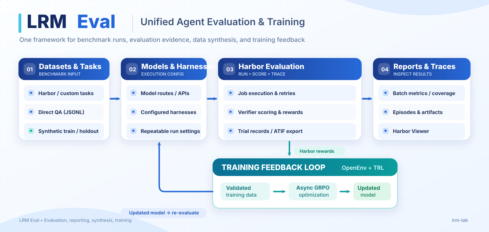

# LRM Eval

LRM Eval 用统一入口评测 Agent 和基础模型。需要工具和沙箱的题由 Harbor 执行，轻量文本或图文题直接调用模型。每次运行用同一套记录格式导出分数、运行状态和可用轨迹，也可以把验收过的合成题交给 OpenEnv 和 TRL 做在线训练。



## 数据集

| Agent 题库 | 数据集 ID | 题包及验证状态 |
|---|---|---|
| DeepSWE 1.1 | `deepswe` | 113 道 Harbor 题，已有 Pi、OpenClaw 历史实跑，本轮跳过复测 |
| Terminal-Bench 2.1 | `terminal` | 89 道 Harbor 题，Pi × Qwen3.8-27B 单题已通过评分及 ATIF 检查 |
| GAIA validation | `gaia` | 165 道 Harbor 题，Pi × Qwen3.8-27B 单题已通过评分及 ATIF 检查，也有 Pi、OpenClaw 历史实跑 |
| WildClawBench | `wildclaw` | 60 道 Harbor 题，保留原评分器和交接包适配器 |

这四套题库由交接包提供。安装、数据位置和单题命令见 [部署与运行](framework/SETUP.md)。单题冒烟用于验证当前执行链路，完整跑分使用各题库的官方评分器、题库版本和分母。

| 计划接入 | 数据集 | 当前状态 |
|---|---|---|
| 通用能力 | MMLU-Pro、HLE、IFBench、BFCL-v4、Multi-LCB、Global-MMLU-Lite、AA-LCR v1.1 | 待登记题库版本和适配评分。BFCL-v4 还需工具调用交互，Multi-LCB 需代码执行环境及测试 |
| 多模态能力 | CMMMU、MMMU-Pro (10c)、MM-IFEval | 待适配各自的题目、图像和评分协议 |

已有 `direct` 入口支持自定义文本和图文 JSONL、精确匹配及 Python 评分器。每个具名 benchmark 的加载、交互与计分仍需按其协议实现和实跑验证。

## 模型和 harness

`--model provider/model-id` 选择模型，`--base-url` 和 `--api-format` 选择网关协议。凭据由执行环境注入。每换一个模型、harness、网关或工具镜像，先跑一道会调用工具的短题，并检查评分和 ATIF。

| Harness | 入口及协议 |
|---|---|
| Pi | `--agent pi`，支持 Chat Completions。Terminal 和 WildClaw 使用交接包适配器 |
| OpenClaw | `--agent openclaw`，支持 Chat Completions。Qwen3.8-27B 合成短题已完成评分，当前版本的 ATIF 工具轨迹待补 |
| OpenCode | `--agent opencode`，已验收版本为 `1.19.3`，Qwen 的 Chat Completions 示例使用 `vllm/Qwen3_8-27B` |
| Codex | `--agent codex`，使用 OpenAI Responses，Qwen3.8-27B 合成短题已完成评分和 ATIF 冒烟 |
| Claude Code | `--agent claude-code`，指定版本并连接 Anthropic Messages。Qwen3.8-27B 的合成短题已通过临时兼容层冒烟 |
| 自定义 | `--agent` 接受 Harbor 原生名称或 Python 导入路径，也可在数据集配置中绑定适配器 |

## 自定义数据集和快速开始

手写题按 [任务格式](framework/DATASET_FORMAT.md) 提供说明、环境、参考解和评分器，在自己的 `harbor.toml` 注册。合成器可按固定种子生成订单对账和离线日志汇总题，支持注册新方法以及可选教师。新题可单题运行、重复指定 `--task`，也可用 `--all` 跑整个数据集。

Linux 执行机准备好 Python 3.12+、Docker、Compose、Buildx 和 `uvx` 后，可以从空目录生成一题并用参考解检查 Docker 和评分。镜像拉取、共享盘运行、网关和代理配置见 [部署与运行](framework/SETUP.md)。这段命令只需要代码和基础 Docker 镜像。

```bash
git clone https://github.com/lrm-lab/lrm-eval.git
cd lrm-eval/framework
python3 -B synthesize.py generate demo-v1 --method log-rollup \
  --train-per-method 1 --holdout-per-method 0
python3 -B synthesize.py check ../datasets/demo-v1
python3 -B run.py demo-v1-train --config ../datasets/demo-v1/harbor.toml \
  --task log-rollup-train-001 --agent oracle --batch demo-oracle \
  --output ../harbor-runs
python3 -B report.py ../harbor-runs/demo-oracle --format markdown
```

设置 `OPENAI_BASE_URL`、`OPENAI_API_KEY` 和与网关匹配的 `MODEL_ROUTE` 后，同一题可换成真实模型。用 `--output` 指定任意可写的结果目录。

```bash
python3 -B run.py demo-v1-train --config ../datasets/demo-v1/harbor.toml \
  --task log-rollup-train-001 --agent opencode --model "$MODEL_ROUTE" \
  --api-format openai_chat_completions --batch demo-smoke --output ../harbor-runs
python3 -B report.py ../harbor-runs/demo-smoke --check-smoke --format markdown
```

## 计分和运行记录

每批有 `episodes.jsonl`、`batch-report.json`、`batch-status.json` 及按 trial UUID 索引的评分和可用 ATIF。报告包含计划、已结束、有效评分、有效样本均分、通过数、覆盖率和故障分类。计划 8 次、5 次有效且全通过时，报告分别显示 **5/5 通过** 和 **5/8 覆盖率**。历史批次缺少计划时可传 `--planned`，逐题补分母可用 `--attempts-per-task`。

在官方评分器完成计分后，用 `report.py --official-result <official.json>` 记录其正式分数及分母。文件字段为 `dataset`、`metric`、`score`、`denominator` 和 `source`。有效均分用于分析本批有效样本。浏览原生会话时，运行 `harbor view <原始作业目录>`。

运行故障用固定摘要和执行机日志位置标识。默认连续三次同类故障会暂停派发，阈值用 `--pause-after` 调整。原配置下给原命令追加 `--resume`，由 Harbor 接着执行未完成的试验。框架会先核对题库、模型、harness、参数及原生配置锁。可复用 `--export-job` 导入已有 Harbor 作业。

## 合成和训练

`synthesize.py generate` 默认生成订单对账和离线日志汇总各 20 道训练候选、6 道留出题。参考解、独立正确产物、空跑、典型错误及评分器故障用 `synthesize.py check` 验收。生成的题包含可直接运行的 `harbor.toml`。在 `[synthesis.methods]` 注册额外的 `module:function`，在 `[synthesis.auditors]` 登记对应的独立验算函数。

可选 `--teacher` 按环境变量 `TIANXI_SYNTH_TEACHER_API_KEY` 调用配置的 Chat Completions 教师，为各模板生成背景、边界条件建议和示范思路。默认教师为 DeepSeek V4.1 Flash，可通过独立配置文件更换端点或模型。

训练候选用同一模型和同一 OpenCode 版本每题采样 8 次，随后运行 `synthesize.py select <episodes.jsonl>`。混合成败组进入 GRPO，0/8 交给强教师实跑，8/8 用于回归，异常或不完整样本进入复核。首轮门槛可用 `--min-grpo` 配置。

训练侧使用 OpenEnv 采集模型实际返回的 token ID、logprob 与 loss mask，Harbor 给奖励，TRL 更新模型并同步权重到 vLLM。先跑 `report.py --check-training-captures <batch>` 核对评分和 trial 级采集文件，再核查一次真实更新和 vLLM 的权重版本。将 OpenEnv 和 vLLM 启动后，运行：

```bash
python3 -B train.py --trl-root "$TRL_ROOT" --plan -- \
  --server "$OPENENV_URL" --vllm-url "$VLLM_URL" --model "$TRAIN_MODEL" \
  --split "$TRAIN_SPLIT" --harness opencode --num-generations 8 --max-steps 1
```

SFT 需要源 trial、工具调用到结果的配对关系和对应的实际模型请求。发生上下文压缩时按请求窗口分段，记录目标起始位置。训练入口、采集协议及分段思路见以下来源。[TRL Harbor 示例](https://github.com/huggingface/trl/tree/main/examples/async_grpo_harbor) · [OpenEnv Harbor](https://github.com/openenv/OpenEnv/blob/main/docs/source/environments/harbor.md) · [Roller 计分和轨迹产物](https://github.com/Valen-Team/Roller/blob/main/README_zh-CN.md)
